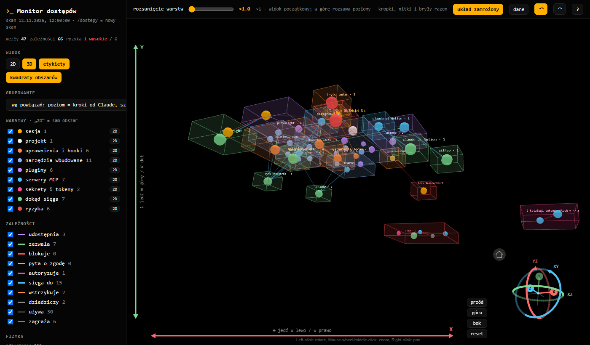
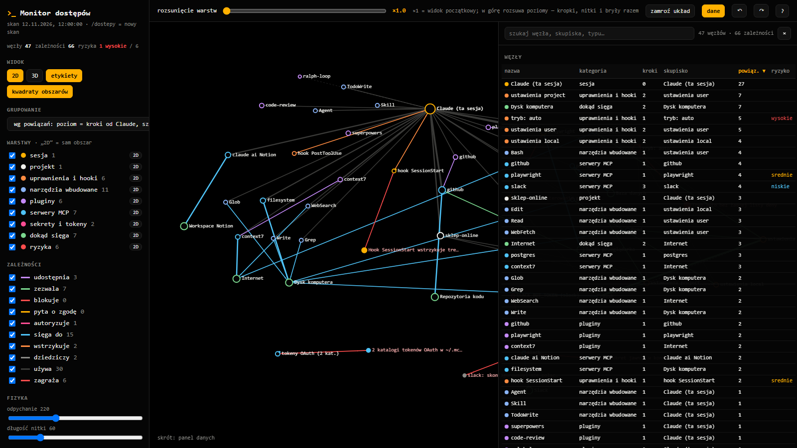

<!-- SPDX-License-Identifier: PolyForm-Noncommercial-1.0.0 · Copyright (c) Mateusz Wiszniowski · wiszniowski-it.com -->
# Claude Code Access Monitor (Monitor dostępów)

**See what Claude Code can access on your machine — and how it all connects.**
A Claude Code mod (plugin) that scans permissions, MCP servers, plugins, hooks and tokens, assesses risks and shows everything as an interactive 2D/3D dependency network.

[Polska wersja poniżej](#polski)



## What it shows

- **Permissions:** the mode (`default`, `auto`, `bypassPermissions`…), allow / deny / ask rules from every source (user, project, local) and which tool or server each rule applies to.
- **MCP servers:** which are configured, which are actually connected (based on the current session's tools), how many tools they expose and where they reach (repositories, browser, mail, databases…).
- **Plugins and hooks:** enabled and disabled plugins and the hooks from `settings.json`.
- **Secrets and tokens:** key names in MCP server configs (never the values) and OAuth token folders in `~/.mcp-auth`.
- **Risks:** e.g. `auto` mode with no deny list, a `SessionStart` hook injecting content into every session, browser-controlling servers, a secret stored in plain text, stale token copies.

## How it looks

- **Pane in Claude Code** (terminal): a summary of permissions, servers, risks and session activity.
- **`/dostepy`** runs a fresh scan and opens a local page at `http://localhost:7331/monitor.html`:
  - **2D and 3D dependency network**: level = steps away from Claude, box = cluster of strongly linked items, color = category, red sparks = risk;
  - **10 dependency types** (uses, allows, blocks, asks, shares, authorizes, reaches, injects, inherits, threatens), each can be toggled;
  - click a box → 2D view of that area with its **inputs and outputs**;
  - **data panel**: searchable, sortable table of nodes and dependencies, synced with the graph;
  - layer spacing slider, layout freeze, camera presets, undo / redo (`Z` / `Y`), keyboard shortcuts (cheat sheet under `?`);
  - **moving around in 3D**: the graph always rotates around its own center (left mouse button); the axes along the scene edges move the camera — **Y** (left edge) up / down, **X** (bottom edge) left / right, depth with the mouse wheel, click an arrowhead to jump;
  - **gizmo** in the bottom-right corner: **YZ / XZ / XY** rings (drag = rotate around X / Y / Z, click = rotate by 90°), **X / Y / Z** axes (click = view from that side) and a home button (start view).



## Installation

In a Claude Code terminal session:

```
/plugin install monitor-dostepow --marketplace MateuszWDEV/claude-code-access-monitor
```

Confirm adding the marketplace (`y`) and pick a scope (default: user).

From a shell:

```
claude plugin install monitor-dostepow --marketplace MateuszWDEV/claude-code-access-monitor
```

In the desktop app: **+** next to the message box → **Plugins** → **Add marketplace** `MateuszWDEV/claude-code-access-monitor` → **Add plugin**.

## Usage

Type `/dostepy`. The scan also refreshes on its own: at session start and a few times right after (MCP servers connect with a delay), when Claude changes a settings file (`settings*.json`, `.claude.json`, `.mcp.json`, `hooks.json`), and when a tool of a server the scan saw as disconnected runs. An open page pulls new data every 15 s.

| Key | Action |
|---|---|
| `2` / `3` | 2D / 3D view |
| `Z` / `Y` | undo / redo a view change |
| `F` | freeze / unfreeze the layout |
| `D` | data panel |
| `L` / `B` | labels / area boxes |
| `Shift+1` / `Shift+2` / `Shift+3` / `0` | camera: front / top / side / reset |
| `Esc` | whole network, close cards |
| `?` | shortcut cheat sheet |

View settings and shortcuts live in `~/.claude/monitor-dostepow/konfig.json`.

## Requirements

- Claude Code with mod support (function hooks); tested on 2.1.300–2.1.322.
- Python 3 (local page server) and a WebGL browser.
- Internet access when opening the page: the graph libraries load from jsDelivr.
- The VS Code extension does not draw mod panes yet — there, use `/dostepy` and the page in your browser.

## Privacy

Everything happens locally. The mod reads your Claude Code settings, `~/.claude.json` and the file list in `~/.mcp-auth`; from server configs it records only key **names**, and it masks URLs with passwords (`://***@`). Output goes to `~/.claude/monitor-dostepow/` (`graf.json`, `monitor.html`, `konfig.json`), and the page is served on `127.0.0.1` only. Nothing is sent anywhere except fetching the libraries from the CDN.

## Limitations

- The interface is in Polish.
- Risk assessment is a heuristic, not a security audit.
- Where an MCP server reaches is guessed from its name.

## License

© Mateusz Wiszniowski · Mateusz Wiszniowski IT (mwiit) · [wiszniowski-it.com](https://wiszniowski-it.com)

- **Free for noncommercial use** under the [PolyForm Noncommercial License 1.0.0](LICENSE): personal use, study, research, hobby projects, charitable and educational organizations, public institutions.
- **Any use in or for a business, or for profit, requires a commercial license.** Companies can get a free 30-day evaluation license on request. Details and contact: [COMMERCIAL.md](COMMERCIAL.md).

Third-party libraries (loaded from a CDN, not bundled): [force-graph](https://github.com/vasturiano/force-graph) and [3d-force-graph](https://github.com/vasturiano/3d-force-graph) (MIT), [three.js](https://github.com/mrdoob/three.js) (MIT), [d3-force](https://github.com/d3/d3-force) and [d3-quadtree](https://github.com/d3/d3-quadtree) (ISC).

---

<a id="polski"></a>
## Polski

**Do czego Claude Code ma dostęp na Twoim komputerze — i co z czego wynika.**
Mod (plugin) do Claude Code, który skanuje uprawnienia, serwery MCP, pluginy, hooki i tokeny, ocenia ryzyka i pokazuje wszystko jako interaktywną sieć powiązań 2D/3D.


### Co pokazuje

- **Uprawnienia:** tryb (`default`, `auto`, `bypassPermissions`…), reguły allow / deny / ask z każdego źródła (user, project, local) i to, do jakiego narzędzia lub serwera każda reguła się odnosi.
- **Serwery MCP:** które są skonfigurowane, które naprawdę połączone (na podstawie narzędzi bieżącej sesji), ile mają narzędzi i dokąd prowadzą (repozytoria, przeglądarka, poczta, baza danych…).
- **Pluginy i hooki:** włączone i wyłączone pluginy oraz hooki z `settings.json`.
- **Sekrety i tokeny:** nazwy kluczy w konfiguracji serwerów MCP (nigdy wartości) i katalogi tokenów OAuth w `~/.mcp-auth`.
- **Ryzyka:** np. tryb `auto` bez listy deny, hook `SessionStart` wstrzykujący treść do każdej sesji, serwery sterujące przeglądarką, sekret zapisany jawnie w konfiguracji, stare kopie tokenów.

### Jak to wygląda

- **Panel w Claude Code** (w terminalu): podsumowanie uprawnień, serwerów, ryzyk i aktywności sesji.
- **`/dostepy`** robi nowy skan i otwiera lokalną stronę `http://localhost:7331/monitor.html`:
  - **sieć powiązań 2D i 3D**: poziom = liczba kroków od Claude, sześcian = skupisko elementów silnie ze sobą powiązanych, kolor = kategoria, czerwone iskry = ryzyko;
  - **10 typów zależności** (używa, zezwala, blokuje, pyta, udostępnia, autoryzuje, sięga do, wstrzykuje, dziedziczy, zagraża), każdy do włączenia i wyłączenia;
  - klik w sześcian → widok 2D obszaru z jego **wejściami i wyjściami**;
  - **panel danych**: tabela węzłów i zależności z szukaniem i sortowaniem, zsynchronizowana z grafem;
  - suwak rozsunięcia warstw, zamrażanie układu, presety kamery, cofanie zmian (`Z` / `Y`), skróty klawiszowe (ściąga pod `?`);
  - **poruszanie się w 3D**: graf obraca się zawsze wokół swojego środka (lewy przycisk myszy); osie na brzegach sceny to jazda kamerą — **Y** (lewy brzeg) w górę / w dół, **X** (dolny brzeg) w lewo / w prawo, w głąb kółkiem myszy, klik w grot = skok;
  - **gizmo** w prawym dolnym rogu: obręcze **YZ / XZ / XY** (ciągnij = obrót wokół osi X / Y / Z, klik = obrót o 90°), osie **X / Y / Z** (klik = widok z tej strony) i domek (widok startowy).


### Instalacja

W sesji Claude Code w terminalu:

```
/plugin install monitor-dostepow --marketplace MateuszWDEV/claude-code-access-monitor
```

Potwierdź dodanie marketplace (`y`) i wybierz zakres (domyślnie: użytkownik). Z powłoki: `claude plugin install monitor-dostepow --marketplace MateuszWDEV/claude-code-access-monitor`. W aplikacji desktop: **+** obok pola wiadomości → **Plugins** → **Add marketplace** → **Add plugin**.

### Użycie

Wpisz `/dostepy`. Skan odświeża się też sam: na starcie sesji i kilka razy zaraz po nim (serwery MCP łączą się z opóźnieniem), gdy Claude zmieni plik ustawień (`settings*.json`, `.claude.json`, `.mcp.json`, `hooks.json`) i gdy zadziała narzędzie serwera, który skan widział jako niepołączony. Otwarta strona dociąga nowe dane co 15 s. Skróty klawiszowe — jak w tabeli wyżej; ustawienia widoku i skróty zmienisz w `~/.claude/monitor-dostepow/konfig.json`.

### Wymagania, prywatność, ograniczenia

- Claude Code z obsługą modów (function hooks), Python 3, przeglądarka z WebGL, internet przy otwieraniu strony (biblioteki z jsDelivr). Rozszerzenie VS Code nie rysuje jeszcze paneli modów — tam działa `/dostepy` i strona w przeglądarce.
- Wszystko dzieje się lokalnie: z konfiguracji serwerów zapisywane są tylko **nazwy** kluczy, adresy z hasłem są maskowane, strona jest serwowana tylko na `127.0.0.1`.
- Interfejs jest po polsku. Ocena ryzyk to heurystyka, nie audyt bezpieczeństwa. To, dokąd prowadzi serwer MCP, jest zgadywane po jego nazwie.

### Licencja

- **Za darmo do użytku niekomercyjnego** — [PolyForm Noncommercial 1.0.0](LICENSE): prywatnie, nauka, badania, hobby, organizacje non-profit, szkoły i instytucje publiczne.
- **Użycie w firmie lub w celu zarobkowym wymaga licencji komercyjnej.** Firmy mogą na prośbę dostać bezpłatną 30-dniową licencję testową. Szczegóły i kontakt: [COMMERCIAL.md](COMMERCIAL.md).
